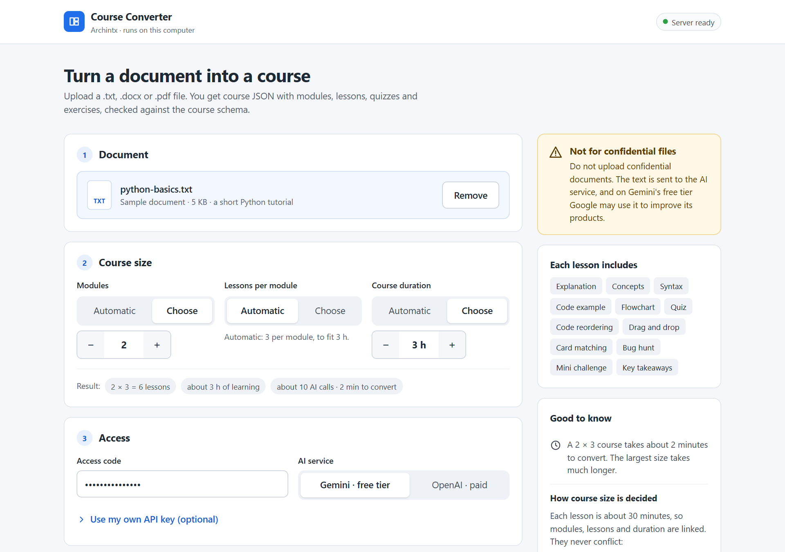
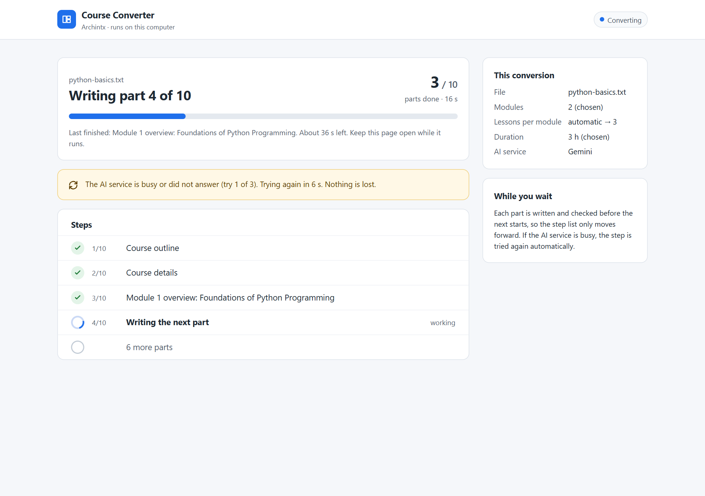
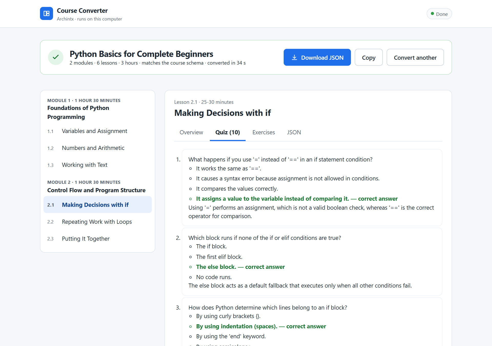
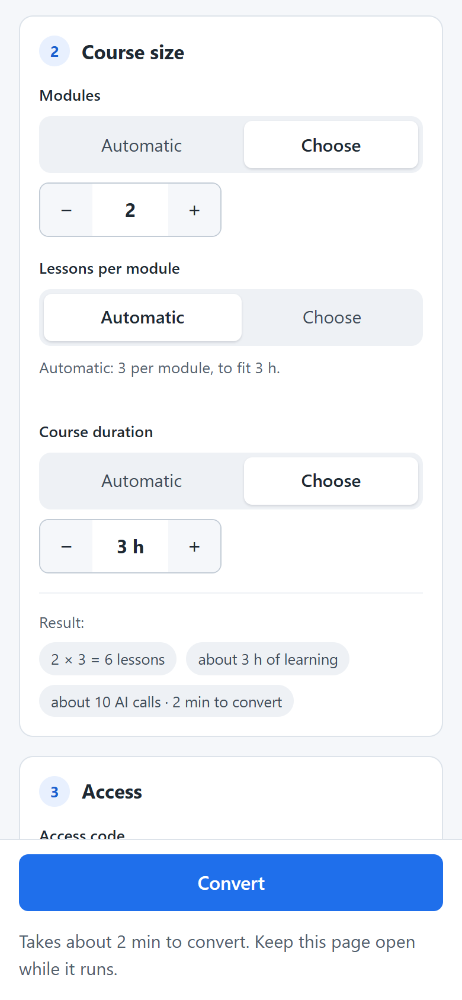

# Archintx Course Converter

Turns a `.txt`, `.docx` or `.pdf` file into a ready-made course: modules, lessons, code
examples, quizzes and exercises, saved as a JSON file.

It runs on your own computer. Only the AI part goes online (Google Gemini, free).

> **Privacy:** your document's text is sent to the AI service. Do not use confidential files.

## What it looks like

**1. Choose a file and the course size** (each size setting can be Automatic or chosen)



**2. Watch it convert** (busy moments at Gemini are retried automatically)



**3. Read the course and download the JSON**





**4. It also works on a phone.**

These screenshots replay a real Gemini conversion of the sample file
([docs/examples/python-basics-txt.json](docs/examples/python-basics-txt.json)),
sped up: a real run takes about 2 minutes.

<br clear="right">

The commands below are for **Windows** (PowerShell). On **macOS or Linux**, use the
commands marked "Mac/Linux".

---

## Part 1: Set up (once, about 15 minutes)

### Step 1. Install Python

1. Download Python **3.12 or newer** from <https://www.python.org/downloads/>.
2. Run the installer. On the first screen, tick **"Add python.exe to PATH"**, then click
   **Install Now**.
3. Open **PowerShell** (press the Windows key, type `PowerShell`, press Enter) and check:

   ```powershell
   python --version
   ```

   You should see `Python 3.12` or higher. (Mac/Linux: `python3 --version`.)

### Step 2. Download the project

Either:

- **With Git:**

  ```powershell
  git clone https://github.com/hemanthkumaralwar/archintx-course-converter.git
  ```

- **Without Git:** on the GitHub page, click **Code → Download ZIP**, then unzip it.

Then go into the project folder (change the path if you saved it somewhere else):

```powershell
cd archintx-course-converter
```

### Step 3. Install the project's packages

```powershell
python -m venv venv
```

```powershell
venv\Scripts\activate
```

Mac/Linux: `python3 -m venv venv` then `source venv/bin/activate`.

Your prompt now starts with `(venv)`. Then install:

```powershell
pip install -r requirements-dev.txt
```

This takes a few minutes.

### Step 4. Get a free Gemini key

1. Go to <https://aistudio.google.com/apikey> and sign in with a Google account.
2. Click **Create API key** and copy it.

### Step 5. Put your key in the settings file

```powershell
copy .env.example .env
```

```powershell
notepad .env
```

Mac/Linux: `cp .env.example .env` then `nano .env`.

In the file, change these two lines, then save and close:

```env
GEMINI_API_KEY=paste-your-key-here
DEMO_ACCESS_CODE=pick-any-password
```

`DEMO_ACCESS_CODE` is a password you make up. The web page asks for it, so nobody else
can use your key.

### Step 6. Check that everything works (optional)

```powershell
pytest -q
```

All tests should pass. They don't use the internet.

---

## Part 2: Convert a document

Choose **A** (web page, easiest) or **B** (command line).

### A. Web page

1. Start the server:

   ```powershell
   uvicorn app.main:create_app --factory
   ```

2. Open <http://localhost:8000> in your browser.
3. Choose your file (or click **Use the sample document**).
4. Set the course size, or leave everything on **Automatic**.
5. Type your `DEMO_ACCESS_CODE` and click **Convert**.
6. When it's done, click **Download JSON**.

To stop the server, press **Ctrl+C** in PowerShell.

### B. Command line

```powershell
python -m converter.cli samples/inputs/python-basics.pdf --modules 2 --lessons 3 -o course.json
```

This converts the sample file into `course.json` in about 2 minutes. To convert your own
file, replace `samples/inputs/python-basics.pdf` with its path.

Course size options (all optional; leave them out for automatic):

| Option | Meaning |
|---|---|
| `--modules 2` | Number of modules (1–30) |
| `--lessons 3` | Lessons in each module (1–8) |
| `--hours 3` | Course length in hours (1–32); about 2 lessons per hour |

You can use any two of these, but not all three.

---

## Every time after the first

Open PowerShell and run:

```powershell
cd archintx-course-converter
```

```powershell
venv\Scripts\activate
```

Then go to Part 2.

---

## If something goes wrong

| Problem | What to do |
|---|---|
| `python` is not recognized | Reinstall Python and tick **"Add python.exe to PATH"**. Mac/Linux: use `python3`. |
| `activate` says "running scripts is disabled" | Run `Set-ExecutionPolicy -Scope Process Bypass`, then `venv\Scripts\activate` again. This only affects the current PowerShell window. |
| `pip`, `pytest` or `uvicorn` is not recognized | The `(venv)` part is missing: run `venv\Scripts\activate` first. |
| "GEMINI_API_KEY is missing" | Check Step 5: the key is in `.env`, and the file is saved. |
| Web page: "access code is missing or wrong" | Type exactly the `DEMO_ACCESS_CODE` from `.env`. |
| Web page: "Conversions are switched off" | Set `DEMO_ACCESS_CODE` in `.env`, then restart the server. |
| "503 high demand" | Gemini is busy. Wait a minute and run the same command again; the command line continues where it stopped. |
| Scanned PDF gives no text | Not supported; the PDF must contain real text. |

---

## More information

- [docs/TECHNICAL.md](docs/TECHNICAL.md): how it works, web API, developer commands
- [docs/DEMO.md](docs/DEMO.md): a 15-minute demo script
- [docs/TEST_RESULTS.md](docs/TEST_RESULTS.md): real conversion results
- [docs/examples/](docs/examples/): finished example courses
- To use OpenAI (paid) instead of Gemini, set `LLM_PROVIDER=openai` and `OPENAI_API_KEY` in `.env`.
