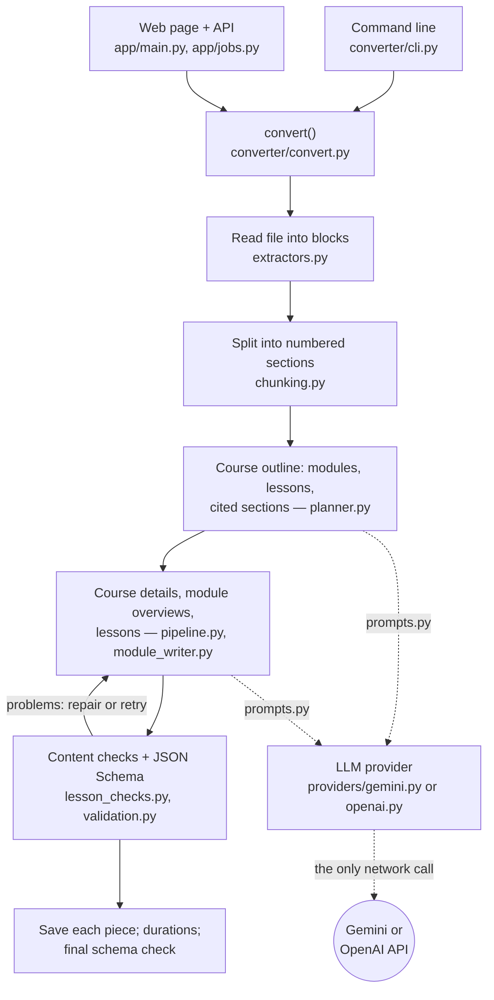

# Technical documentation — Archintx Course Converter

The converter turns course material in a `.txt`, `.docx` or `.pdf` file into course JSON in the
format of the team's reference course, [`samples/javascript-beginner.json`](../samples/javascript-beginner.json):
a course with modules, each module with lessons, and each lesson with explanations, code
examples, a Mermaid flowchart, a 10-question quiz, code reordering, drag-and-drop, card
matching, a bug hunt, a mini challenge, use cases, a story and key takeaways.

It runs on the user's own computer, as a command-line tool or a local web page. The only
network use is the call to the LLM API (Google Gemini by default, OpenAI optionally).

Contents: [1 Architecture](#1-architecture) · [2 Modules](#2-modules) · [3 Conversion step by step](#3-conversion-step-by-step) ·
[4 Output rules](#4-output-rules) · [5 Prompt design](#5-prompt-design) · [6 LLM providers](#6-llm-providers) ·
[7 Reliability](#7-reliability) · [8 Security](#8-security) · [9 Configuration](#9-configuration) ·
[10 Testing](#10-testing) · [11 Limits and known issues](#11-limits-and-known-issues) · [12 Decision log](#12-decision-log)

---

## 1. Architecture

Design principles:

- **Small, checked steps.** One LLM call per piece (outline, course details, each module
  overview, each lesson). A full lesson is about 15,000 characters of JSON; asking for one at a
  time keeps answers inside output limits and lets a failed piece be retried alone.
- **Everything is checked by code**, never trusted: the JSON Schema plus about 20 content rules
  taken from the team's sample (section 4).
- **Each piece is saved as soon as it is valid**, so a stopped run resumes where it stopped.
- **The LLM is behind a one-method interface**, so Gemini, OpenAI and a test fake are
  interchangeable, and the tests never touch the network.

## 2. Modules

| File | Responsibility |
|---|---|
| `converter/cli.py` | Command line: arguments, progress output, exit codes 0 / 1 / 2 / 130 |
| `converter/convert.py` | The conversion flow, the work folder per file, durations |
| `converter/extractors.py` | `.txt` / `.docx` / `.pdf` to ordered heading and paragraph blocks, with file limits |
| `converter/chunking.py` | Blocks to numbered sections (`s1`, `s2`, …) of at most 3,000 characters |
| `converter/planner.py` | Course size (automatic or chosen) and the outline from the sections |
| `converter/pipeline.py` | Shared writing loop: course details, overviews, lessons, progress, final check |
| `converter/module_writer.py` | One module overview or one lesson: LLM call, repairs, validation, rejected-answer files |
| `converter/lesson_checks.py` | Content rules the schema cannot express, and mechanical repairs |
| `converter/prompts.py` | Every prompt, the quality rules, the outline schema, the document block |
| `converter/providers/` | `LLMProvider` interface (`base.py`), `GeminiProvider`, `OpenAIProvider`, `get_provider()` |
| `converter/config.py` | Constants (course format, retries) and `Settings` read from `.env` |
| `converter/checkpoint.py` | Saving and checking the outline (and the old generator's plan) |
| `converter/retry.py` | Retry loop with error feedback and back-off |
| `converter/schema_utils.py`, `validation.py`, `json_utils.py` | Schemas per step, readable validation errors, safe JSON files |
| `converter/generate.py`, `user_input.py` | The original title-based generator (still works; see `docs/LEGACY_GENERATOR.md`) |
| `app/main.py` | Web API, upload page, security headers |
| `app/jobs.py` | Background conversion jobs, one at a time |
| `app/extraction.py` | Reading an upload in a separate process with a 60-second limit |
| `app/static/` | The upload page (HTML, CSS, JavaScript) |
| `tools/` | `validate_json.py`, `generate_schema.py`, `make_sample_inputs.py` |

## 3. Conversion step by step

For `python -m converter.cli notes.pdf --modules 2 --lessons 3`:

| # | Step | LLM calls | Code |
|---|---|---|---|
| 1 | Read the file into blocks (headings with levels, paragraphs; tables as `cell \| cell` rows) | 0 | `extract_blocks()` |
| 2 | Group blocks into sections at headings, at most 3,000 characters each | 0 | `split_sections()` |
| 3 | Course size: as given, or one lesson per 3,000 characters (2–64 lessons, at most 8 per module) | 0 | `auto_course_size()` |
| 4 | Outline: course title, level, module titles, lesson titles, and the section ids each lesson teaches | 1 | `generate_outline()` |
| 5 | Course details (description and other course-level fields) | 1 | `generate_course_details()` |
| 6 | For each module: an overview from the sections its lessons cite, then each lesson from **only its own cited sections** | 1 per overview and lesson | `write_course()` |
| 7 | Module durations = sum of their lessons; course `totalDuration` = sum of modules | 0 | `set_durations()` |
| 8 | Final check of the whole file against `schema/course_schema.json` | 0 | `finish()` |

A 2 × 3 course takes about 10 calls and 1.5–3 minutes on `gemini-3.1-flash-lite`; the largest
automatic size (8 × 8) takes about 74 calls. IDs are set by code in the sample's pattern
(`python-basics-for-complete-beginners-beginner-v1-mod-2-lesson-1`).

Work in progress lives in `output/<file name>-<first 12 characters of the file's SHA-256>/`:
`outline.json` (with the file hash and size) and `course/course.json`. Running the same command
again reuses every saved piece. An edited file has a different hash, so it starts fresh.

## 4. Output rules

Every lesson must pass **the JSON Schema** (`schema/course_schema.json`, built from the sample by
`tools/generate_schema.py`, with exact item counts per lesson from `config.LESSON_ITEM_COUNTS`) and
**the content checks** in `lesson_checks.py`. The checks follow the team's sample; where the
original code disagreed with the sample, the sample won (Step 2):

| Rule | Value |
|---|---|
| Objective | "By the end of this lesson, you will be able to:" with exactly 3 numbered points |
| Syntax example | 1–6 lines |
| Lists | 8 concepts, 8 parts (`Step 1` … `Step 8`), 5 examples (`Example 1:` …), 10 quiz questions, 6 takeaways, 3 use cases, 2 hooklines |
| Quiz | `correctAnswer` is the option index as text ("0"–"3"), within the options |
| Code reordering | 6 lines, each starting `// N.`; shuffled; `correctOrder` matches the step numbers |
| Drag and drop | 6 items, 2+ buckets used, no item names its own bucket |
| Card matching | 12 cards in 6 pairs; terms up to 4 words (code snippets allowed); descriptions do not name their term |
| Diagrams | Mermaid `flowchart`; every node connected; loops allowed |
| Takeaways | item 5 starts "⚠️ Common Mistake:", item 6 "💡 Pro Tip:" |
| Lesson title | no "Lesson 1:" prefix |

Of the sample's 64 lessons, 56 pass every check; the other 8 have genuine slips (an answer given
away in the text, unconnected boxes in one diagram) and are listed in `tests/test_lesson_checks.py`.

When a check fails, **mechanical repairs** run first (rebuilding `correctOrder`, adding a missing
Mermaid fence). If all remaining problems are in one field, a **small repair call** asks the model
to fix only that field (up to 2 rounds); otherwise the whole lesson is retried with the problems
listed in the prompt.

## 5. Prompt design

All prompts are in `converter/prompts.py`.

- **Outline prompt:** the required size, the allowed section ids, and the document. Documents up
  to 60,000 characters are shown in full; larger ones as the first 600 characters of each section
  (Step 8 showed that excerpts alone hid the topics of heading-less PDF sections).
- **Lesson prompt:** course details, module overview, earlier lesson titles (to avoid repetition),
  exact list sizes, the format rules above, the quality rules, and the lesson's cited sections
  (at most 12,000 characters).
- **Grounding rule** (Step 9): explanations, concepts, syntax, examples and takeaways are based on
  the source and never contradict it; quizzes and exercises are written by the model but test
  what the source teaches; where a short source cannot fill the required counts, standard
  material on the same topic may be added, but no other lesson's topic.
- **Error feedback:** a rejected answer's problems (up to 15) are added to the next attempt's prompt.

## 6. LLM providers

`providers/base.py` defines one method: `generate_json(prompt, schema, label)`. `get_provider()`
picks the provider from `LLM_PROVIDER` in `.env` (or `--provider` / the web form).

| Provider | How structured output is enforced | Notes |
|---|---|---|
| Gemini (default) | `response_json_schema` with the step's schema | Free tier; model `gemini-3.1-flash-lite` (tested in `docs/SPIKE_GEMINI.md`) |
| OpenAI (optional) | Strict JSON-schema mode; `to_strict_schema()` closes every object, makes all fields required, drops `$schema`, and wraps non-object schemas as `{"value": ...}` | Paid; tested with a stand-in client only (no key at ₹0 budget) |

## 7. Reliability

| Mechanism | Detail |
|---|---|
| Retries | Up to 3 attempts per piece. API failures (for example Gemini's "503 high demand", 429 rate limit) wait 15 s, then 30 s. Validation failures retry at once with their problems in the prompt. Programming errors are not retried, so they keep their traceback and do not waste quota. |
| Resume | Every valid piece is saved immediately (atomic file writes). Re-running the same command continues from the next missing piece; this was confirmed against the real API in Step 11. |
| Final check | The finished file is read back from disk and validated against the full schema. |
| Durations | Read from each lesson; an unreadable value counts as 30 minutes (logged); totals are exact ("1 hour 15 minutes"). |

## 8. Security

| Area | Measure |
|---|---|
| Uploaded / input files | Type checked by extension **and** first bytes; 10 MB, 200 PDF pages, 500,000 characters; `.docx` unpacked size checked (50 MB) before parsing (zip bombs); XML entities not resolved; password-protected and scanned PDFs rejected; in the web app, reading runs in a separate process stopped after 60 s |
| Prompt injection | Document text is placed only inside `<document>` … `</document>` after all instructions, with a warning that nothing in it is an instruction; `<document>` tags written inside the document are neutralised |
| API keys | Read from `.env` (git-ignored) or the environment once at start; hidden from `repr(Settings)`; removed from any SDK error text; a key pasted into the web page is used for that job only |
| Logs | Never contain document text, prompts, model output or keys; validation failures log only how many problems were found |
| Web app | Access code required on every `/api` route (constant-time compare; switched off when not set); upload size checked from `Content-Length` before the body is read; file names sanitised; one job at a time; temp files deleted after each job; error responses never include paths, tracebacks or echoed input |
| Web page | `Content-Security-Policy: default-src 'self'` with `frame-ancestors 'none'`; no inline script or style; model output shown with `textContent` only; no browser storage of secrets |
| Dependencies | Pinned in `requirements*.txt`; `pip-audit` reports no known vulnerabilities (two were found and fixed in Step 0) |
| Privacy | The document text is sent to the LLM API. On Gemini's free tier Google may use it to improve its products, so confidential documents should not be converted there (warning shown in the README and on the page) |

## 9. Configuration

`.env` (copy from `.env.example`):

| Variable | Default | Purpose |
|---|---|---|
| `LLM_PROVIDER` | `gemini` | `gemini` or `openai` |
| `GEMINI_API_KEY` | — | Required for Gemini |
| `GEMINI_MODEL` | `gemini-3.1-flash-lite` | |
| `OPENAI_API_KEY` | — | Required for OpenAI |
| `OPENAI_MODEL` | `gpt-4o-mini` | Not verified live |
| `DEMO_ACCESS_CODE` | empty (web conversions off) | Code the web page asks for |

Format and behaviour constants are in `converter/config.py` (item counts, objective points,
syntax lines, retries and back-off), `converter/extractors.py` (file limits),
`converter/chunking.py` (section size), `converter/planner.py` (automatic size) and
`converter/prompts.py` (prompt sizes).

## 10. Testing

- **452 tests** (`pytest`), **96 % line and branch coverage**; results in `docs/TEST_RESULTS.md`.
- **No network in tests:** every LLM call goes to `tests/fakes.FakeProvider`, which returns real
  content from the team's sample; a guard fails any test that opens a non-local connection.
- **Test files are built at run time** (Word files, PDFs, zip archives), so no binary fixtures.
- **Deliberate-bug checks:** at every step, key lines were broken on purpose to confirm the tests
  notice (for example: access code not checked, zip-bomb check off, key not redacted).
- **Real runs** against Gemini are recorded in `docs/TEST_RESULTS.md` (outlines, a reviewed
  lesson, three full conversions).
- **Lint:** `ruff` (PEP 8, unused code, likely bugs, complexity ≤ 10 per function).
  The page's JavaScript has no linter (Node.js not installed); `tests/test_web_page.py` checks
  its security rules instead.

## 11. Limits and known issues

| Item | Status |
|---|---|
| Free-tier quota | Per Google AI Studio project; a full 8 × 8 course is about 74 calls. Runs resume after a quota stop. |
| Gemini busy periods | "503 high demand" happened in two of the real test sessions, sometimes outlasting the 15 s + 30 s waits. The run then stops with a one-line error; running the same command again continues (confirmed twice). |
| Scanned PDFs, images, `.doc` / `.rtf` / `.odt` | Not supported (no OCR) |
| Tables | Become `cell \| cell` lines; layout is not kept |
| Web jobs | In memory: one server process, forgotten on restart; one job at a time |
| Output quality vs sample | Close on most measures; durations written as a range ("25-30 minutes") and examples about one line shorter. Fix decision pending: PLAN.md Step 15Q and follow-ups F1–F3 |
| OpenAI | Tested only with a stand-in client |
| Documents over 60,000 characters | Outline uses excerpts; not yet run against the real model |

## 12. Decision log

The full reasoning is in [PLAN.md](../PLAN.md) (each step's "Done" note). Main decisions:

| Date | Decision |
|---|---|
| Step 0 | Reuse the original generator's code (pipeline, checks, retries) instead of starting over; private GitHub repository |
| Step 2 | Content rules follow the team's sample, not the original code (3 objective points, loops allowed in diagrams, code allowed as card terms) |
| Step 6a | LLM behind a one-method interface; settings read once, never at import |
| Step 8 | Lessons cite section ids; documents up to 60,000 characters shown in full to the outline step |
| Step 9 | Grounding rule relaxed so short sections can still fill the fixed lesson format |
| Step 10 | Work folder keyed by the file's SHA-256 for resume and fresh runs; exact durations |
| Step 11 | Longer back-off after Gemini's "503 high demand" |
| Step 12–13 | Local web app with access code, strict CSP, separate-process file reading |
| 2026-11-20 | Local use only: CI and hosting skipped; only the LLM API is online |
